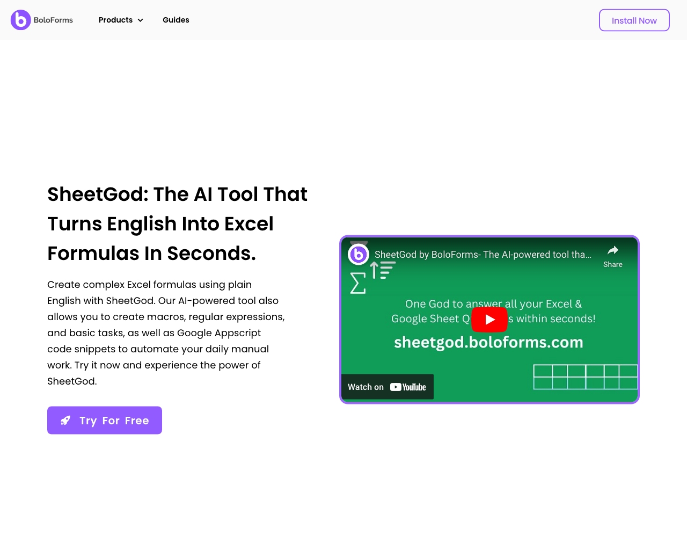
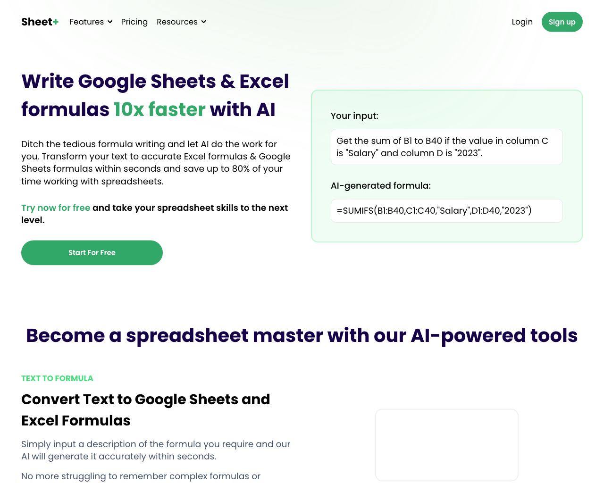
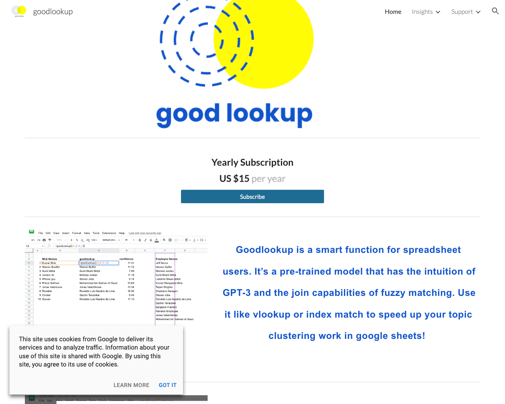

# 🗂️ Spreadsheets

This page lists a collection of 🗂️ Spreadsheets tools.

## Tools

### [Sheet AI](https://www.sheetai.app)

 
- **Link**: https://www.sheetai.app
- **Pricing**: -

### [SheetGod](https://www.boloforms.com/sheetgod)

 
- **Link**: https://www.boloforms.com/sheetgod
- **Pricing**: -

### [Sheet+](https://sheetplus.ai)

 
- **Link**: https://sheetplus.ai
- **Pricing**: -

### [Excel Formula Bot](https://excelformulabot.com)

 
- **Link**: https://excelformulabot.com
- **Pricing**: -

### [Goodlookup](https://www.goodlookup.com)

 
- **Link**: https://www.goodlookup.com
- **Pricing**: -

### [GPT for Sheets](https://docgpt.ai/gpt-for-sheets)

 
- **Link**: https://docgpt.ai/gpt-for-sheets
- **Pricing**: Free trial

[Go back](../README.md) [JSON](json/Spreadsheets.json)